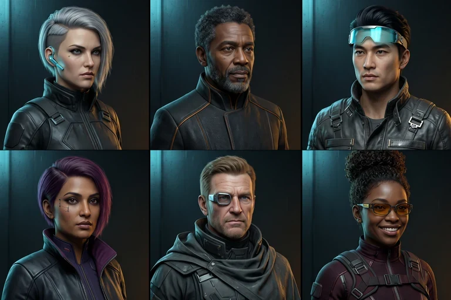

# CYBER CYPHER — premium agent portrait production

**Status: First six visual proofs ready for review. Not live in the game.**

## The approved design family

Cyber-noir London 2035; realistic adult spy portraits, cinematic black titanium clothing, physically rendered skin/hair/fabrics, dark teal / smoked-glass portrait background, cyan #22E4FF with restrained amber #FFB020 edge light. Real individuals with instantly recognisable different face, age, hair and clothing. Avoid flat icons, cartoons, toy-like avatars, duplicate faces or artwork with words.

The reference production atlas was generated once from Creative Claw Nano Banana 2 at 2K 3:2 for **24 credits**, then cropped and compressed with free GitHub Actions tooling into six 256×256 WebP proof images.

## First six proofs

| ID | Agent | Intended identity |
|---|---|---|
| 00 | Static | Silver asymmetric undercut, cyan earpiece, black graphite jacket |
| 01 | Cipher | Mature analyst, close curls and grey beard, amber-edged tailored jacket |
| 02 | Neon | Sharp courier with dark swept-back hair, pale cyan raised visor |
| 03 | Glitch | Confident woman with dark purple side-part, cool-toned tactical collar |
| 04 | Vector | Rugged older engineer, mechanical monocle, layered gunmetal coat |
| 05 | Pixel | Smiling hacker, high curly bun, amber-lens eyewear and burgundy gear |

Direct source: [original 2K Creative Claw atlas](https://cdn.creativeclaw.co/u/049bef39/images/c749d040-4ad4-4f97-8450-1edc9d843dd9.png). Six cropped proofs are in this directory as `agent-00.webp` through `agent-05.webp`, with precise dimensions and hashes in [QA.json](avatar-preview/QA.json).

## Rest of the character bible

The remaining 18 agents are **not generated**. These directions avoid visual repetition and fit a cost-controlled 3×2 atlas workflow, subject to approval of the first six.

| Sheet | Agent names and distinct art direction |
|---|---|
| 2 | **Nova** — mature Latina strategist with copper curls and amber collar; **Rook** — stocky Welsh security expert with cropped grey mohawk, scarred brow and graphite armour; **Echo** — thoughtful East Asian female signals operative with pearl bob and silver headset; **Flux** — North African male data infiltrator with long dark swept locs and teal goggles; **Kestrel** — athletic middle-aged woman with dark braided crown and sleek olive stealth suit; **Onyx** — broad-shouldered West African gentleman in a satin black tailored coat, close-shaven hair, understated jewellery |
| 3 | **Juno** — sophisticated South Asian woman with chestnut ponytail and tailored amber-lined suit; **Halcyon** — elderly white woman strategist with white pixie crop and elegant glasses; **Quark** — young Black male engineer with russet twists and optic gauntlet; **Raven** — middle-aged white male infiltrator with shoulder-length dark hair, narrow face and black trench; **Siren** — Mediterranean woman with sleek dark waves, silver necklace and dark plum coat; **Tango** — Latino man with short shaved hair, bright smile and amber pilot jacket |
| 4 | **Umbra** — dark-skinned woman in matte black stealth hood with visible expressive face; **Volta** — blond Scandinavian male technician with brushed-gold optic and pale graphite jacket; **Wraith** — gaunt older Asian male spy with neat white moustache and black raised collar; **Xeno** — East Asian female cybernetic researcher with cropped cobalt hair and a unique transparent face optic; **Yara** — Black British woman with short copper-toned natural curls and a confident angular cloak; **Zephyr** — youthful Middle Eastern male pilot with wavy dark hair, subtle cyan headset and bespoke burgundy coat |

No text or nametags should be baked into portrait graphics. Existing app code supplies agent names and names remain bound to the current numeric avatar IDs.

## Credit plan

| Step | Nano Banana 2 estimated credits |
|---|---:|
| First six portraits (already completed) | 24 |
| Three more 2K 3×2 atlases (not ordered) | 72 |
| Local WebP cropping and production integration | 0 |
| **Potential total for 24 if the proofs are approved** | **96** |

Creative Claw's last confirmed balance after the first sheet is **183 credits**. No other paid avatar generations have been ordered. If approved, three further sheets are expected to leave about **111 credits**, before revisions.

## Implementation and release gate

**Do not put `agent-00.webp` into `public/assets/avatars` yet.** The current `tools/shared.js` switches all 24 portrait slots from their SVG fallbacks when it sees `agent-00.webp`, so partial installation will create broken faces.

Release all 24 matching 256×256 WebPs **in one atomic commit**, after visual review of all sheets, file-size/identity validation and TV/phone avatar picker tests. Ensure the existing room / rejoin / avatar IDs remain completely unchanged. No changes to gameplay, protocol, secrets or audio are needed.

The current music fix is independent: pressing START A ROOM now immediately changes from title music to the existing `mus_lobby.mp3` while screen two opens its secure channel, and the lobby keeps the same track. The music regression tests passed before merging.
